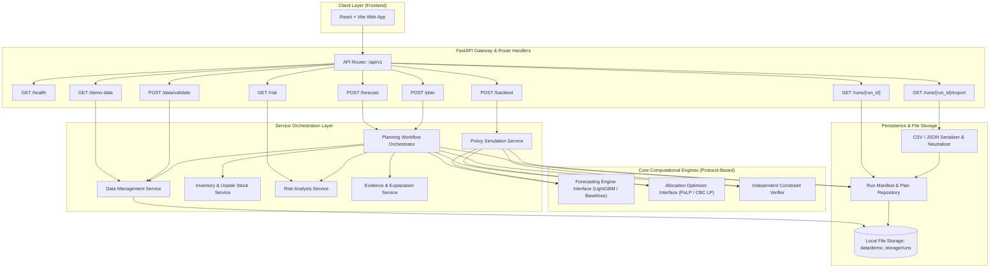

# OPTIQO — BACKEND IMPLEMENTATION PLAN
**Document Version:** 1.0  
**Status:** Architectural Proposal (Pending Task 1 Review & Approval)  
**Target Stack:** Python 3.11+, FastAPI, Pydantic v2, pandas, NumPy, PuLP/CBC, LightGBM, pytest  
**Client:** React + Vite (Frontend Workstream)  
**Core Domain:** FMCG Distribution Intelligence & Inventory Optimization Engine  

---

## 1. Executive Summary & Architectural Principles

Optiqo is a decision-support platform designed to solve the critical FMCG distribution problem: **which product, in what quantity, should be shipped from which warehouse batch to which destination, and why?**

This plan outlines the architecture, data contracts, engine interfaces, folder organization, and testing strategy for a standalone, modular **FastAPI backend**. The design strictly adheres to the product requirements defined in [Optiqo_PRD.md](file:///r:/Optiqo/Optiqo_PRD.md), the system role divisions in [master_context.md](file:///r:/Optiqo/master_context.md), and the backend scope in [backend.md](file:///r:/Optiqo/backend.md).

### Core Architectural Principles
1. **Decoupled Engine Interfaces:** The forecasting module, mathematical optimization engine, and independent constraint verifier are isolated behind strictly typed Python protocols. The backend orchestrates these engines without embedding internal algorithm logic inside API routes or transport layers.
2. **Independent Verification:** Mathematical optimization outputs are never trusted unconditionally. Every proposed plan must pass through an independent, solver-agnostic hard-constraint checker before reaching the user or evaluation simulator.
3. **Reproducibility & Auditability:** Every planning run, forecast, and simulation is deterministic when seeded. Every execution generates an immutable run manifest containing the dataset hash, random seed, software versions, solver status, and KPI summary.
4. **Honest Failure Handling:** Failed validations, solver timeouts, or model errors immediately produce RFC 7807-compliant structured error payloads. No fabricated "successful" fallback plans are ever presented as final or optimal.
5. **Separation of Forecasting and Allocation Gains:** Simulation infrastructure independently evaluates Baseline 1 (conventional heuristic), Baseline 2 (forecast-driven heuristic), and Optiqo (forecast-driven joint LP), strictly decomposing business benefits into forecasting effects vs. allocation effects.

---

## 2. Requirements Traceability Matrix

| Requirement Area | Source Document & Section | Backend Component Responsible | Acceptance Target |
|---|---|---|---|
| **10 Dataset Tables & Relations** | PRD §11.1, Table 11.1 | `data/loader.py`, `schemas/dataset.py` | Full validation of mandatory & optional fields, foreign keys |
| **13 Validation Fault Types** | PRD §5.1 (P0-02), §11.2, §16.1 (E6) | `data/validator.py` | 100% detection rate on seeded synthetic faults (S3); 0 false errors |
| **Inventory Preparation & Shelf Life** | PRD §5.1 (P0-03), §8.2, §10.2, §10.3 | `services/inventory.py` | Exact usable vs. unusable partitioning; arrival date & FEFO calculation |
| **7-Day Demand Forecasting** | PRD §5.1 (P0-04), §10.4 | `engines/forecasting/` | Leakage-free feature lags; per-group WAPE selection; fallback cascade |
| **Inventory & Supply Risk Analysis** | PRD §5.1 (P0-07), §10.6 | `services/risk.py` | Deterministic ranking by financial exposure; supply shortage flag |
| **Joint Allocation Optimization** | PRD §5.1 (P0-05), §10.2, §10.5 | `engines/optimizer/` | Batch-level LP minimizing freight, unmet demand, expiry & holding penalties |
| **Independent Constraint Verification** | PRD §5.1 (P0-06), §7.4 (O1), §14 (N1) | `engines/verification/` | 0 violations (O1=0) across all plans; corrupted plans strictly rejected |
| **Recommendation Explanations** | PRD §5.1 (P0-08), §10.9, §7.4 (O3) | `services/explainer.py` | 100% grounded explanations; numerical values recomputed by verifier |
| **Policy Replay (B1, B2, Optiqo)** | PRD §5.1 (P0-09), §10.7, §10.8 | `simulation/simulator.py`, `policies/` | 5-step daily simulation over 56-day evaluation window (8 cycles) |
| **KPI Calculation & Evaluation** | PRD §7.1, §7.2, §7.3, §7.4, §7.5 | `simulation/kpi.py` | K1–K8, F1–F5, O1–O5, S1–S4 computed from realized simulation logs |
| **Run Storage & Exports** | PRD §5.1 (P0-11), §6.7, §14 (N8) | `storage/runs.py`, `api/routes/runs.py` | JSON manifest, CSV export with formula-injection neutralization |
| **REST API Contracts** | `backend.md` §32–49, PRD §6.5 | `api/routes/` | 9 core endpoints with comprehensive schemas and error handling |

---

## 3. Modular System Architecture

### 3.1 Architecture Overview



### 3.2 Component Responsibilities & Dependencies

1. **`api/` (Transport Layer):**
   - Implements HTTP endpoints using FastAPI routers.
   - Converts raw requests into Pydantic models.
   - Enforces CORS, request logging, and RFC 7807 error translation.
   - *Dependencies:* Pydantic schemas, Service layer.

2. **`schemas/` (Data Transfer Objects & Domain Models):**
   - Strictly typed models for all incoming payloads, responses, and dataset records.
   - Pydantic v2 validators for format and boundary checks.
   - *Dependencies:* None (pure typing).

3. **`data/` (Data Management & Validation):**
   - Loads CSV/JSON tables into validated pandas DataFrames.
   - Executes the 13 fault-type validation engine.
   - Contains the deterministic synthetic data generator for demo and test datasets.
   - *Dependencies:* `schemas/`, pandas, NumPy.

4. **`services/` (Business Logic & Orchestration):**
   - `inventory.py`: Computes arrival dates, remaining shelf lives, and partitions stock into usable/unusable per lane.
   - `risk.py`: Implements the PRD §10.6 risk formulations (days of cover, unmet demand share, expiry loss, financial exposure).
   - `orchestrator.py`: Orchestrates the single-cycle planning pipeline (Validate -> Usable Stock -> Forecast -> Risk Pre -> Optimize -> Independent Verify -> Explain -> Risk Post -> Store).
   - `explainer.py`: Populates evidence dictionaries and generates grounded explanation sentences from solver slacks and forecast data.
   - *Dependencies:* `data/`, `schemas/`, `engines/`.

5. **`engines/` (Computational Interfaces):**
   - Defined as Python `typing.Protocol` classes to allow independent AI/ML team implementation and backend mocking.
   - `forecasting/`: Generates 7-day daily forecasts, selects best model (Seasonal-Naive, 28-day MA, LightGBM), computes demand scenarios (Low, Mid, High).
   - `optimizer/`: Builds and solves the lot-by-lot batch allocation LP in PuLP/CBC.
   - `verification/`: Completely independent re-verification of all 5 operational hard constraints (C1–C5) on integer-rounded allocations.
   - *Dependencies:* PuLP, LightGBM/scikit-learn (in engine packages), pandas, NumPy.

6. **`simulation/` (Backtesting & Policy Replay):**
   - `simulator.py`: Implements the 5-step daily simulation loop over the 56-day evaluation window.
   - `policies/`: Implements B1 (heuristic nearest warehouse, FEFO, trailing average), B2 (B1 allocation + Optiqo forecast), and Optiqo (joint LP).
   - `kpi.py`: Calculates K1–K8, F1–F5, O1–O5, S1–S4 metrics and gain decompositions.
   - *Dependencies:* `engines/`, `services/`, `data/`.

7. **`storage/` (Persistence & Neutralized Export):**
   - File-based persistence of run manifests, plan CSVs, risk tables, and backtest logs.
   - CSV export sanitizer ensuring protection against CSV injection (`=`, `+`, `-`, `@`).
   - *Dependencies:* `schemas/`.

---

## 4. Proposed Backend Directory Structure

```text
r:/Optiqo/
├── backend/
│   ├── api/
│   │   ├── __init__.py
│   │   ├── dependencies.py          # FastApi DI (settings, repos, services)
│   │   ├── middleware.py            # Error handling, timing, CORS
│   │   └── routes/
│   │       ├── __init__.py
│   │       ├── health.py            # GET /api/health
│   │       ├── data.py              # GET /api/demo-data, POST /api/data/validate
│   │       ├── forecast.py          # POST /api/forecast
│   │       ├── plan.py              # POST /api/plan
│   │       ├── risk.py              # GET /api/risk
│   │       ├── backtest.py          # POST /api/backtest
│   │       └── runs.py              # GET /api/runs/{run_id}, GET /api/runs/{run_id}/export
│   ├── core/
│   │   ├── __init__.py
│   │   ├── config.py                # App configuration, env variables, paths
│   │   ├── exceptions.py            # Domain exceptions (OptiqoError hierarchy)
│   │   └── logging.py               # Structured logging setup
│   ├── schemas/
│   │   ├── __init__.py
│   │   ├── common.py                # Status enums, RFC 7807 ProblemDetails
│   │   ├── dataset.py               # Pydantic schemas for all 10 CSV tables
│   │   ├── validation.py            # ValidationReport, ValidationErrorItem
│   │   ├── forecast.py              # ForecastRequest, ForecastResponse, ScenarioTable
│   │   ├── risk.py                  # RiskTable, RiskAlertItem, SupplyShortageAlert
│   │   ├── plan.py                  # PlanRequest, PlanResponse, PlanLine, EvidenceRecord
│   │   ├── backtest.py              # BacktestRequest, BacktestResponse, KPITable
│   │   └── run.py                   # RunManifest, RunSummary
│   ├── data/
│   │   ├── __init__.py
│   │   ├── loader.py                # CSV ingestion, data type casting, key mapping
│   │   ├── validator.py             # Rule engine for all 13 fault types
│   │   ├── synthetic_generator.py   # Deterministic seeded dataset generator
│   │   └── demo_data/               # Storage directory for default demo CSVs
│   │       ├── skus.csv
│   │       ├── warehouses.csv
│   │       ├── destinations.csv
│   │       ├── lanes.csv
│   │       ├── sales_daily.csv
│   │       ├── inventory_batches.csv
│   │       ├── inbound_shipments.csv
│   │       ├── warehouse_receipts.csv
│   │       ├── calendar_events.csv
│   │       └── config.csv
│   ├── services/
│   │   ├── __init__.py
│   │   ├── inventory.py             # Usable stock, shelf life calculation, arrival dating
│   │   ├── risk.py                  # Risk metrics, exposure ranking, severity flags
│   │   ├── orchestrator.py          # Single-cycle dispatch workflow execution
│   │   └── explainer.py             # Evidence compilation, template-based sentence generation
│   ├── engines/
│   │   ├── __init__.py
│   │   ├── protocols.py             # Python typing.Protocol definitions for all engines
│   │   ├── forecasting/
│   │   │   ├── __init__.py
│   │   │   ├── adapter.py           # Implements ForecasterProtocol
│   │   │   ├── baselines.py         # Seasonal-Naive, 28-day Moving Average
│   │   │   ├── lgbm_model.py        # LightGBM multi-step regressor (Tweedie objective)
│   │   │   └── residuals.py         # Multiplier & uncertainty estimation (Low, Mid, High)
│   │   ├── optimizer/
│   │   │   ├── __init__.py
│   │   │   ├── adapter.py           # Implements OptimizerProtocol
│   │   │   ├── lp_builder.py        # PuLP linear programming model assembly
│   │   │   ├── lot_logic.py         # Lot-by-lot cumulative expiry constraints
│   │   │   └── rounding.py          # Conservative integer rounding & slack reporting
│   │   └── verification/
│   │       ├── __init__.py
│   │       └── checker.py           # Independent hard-constraint verifier (C1-C5)
│   ├── simulation/
│   │   ├── __init__.py
│   │   ├── simulator.py             # 5-step daily simulation loop over evaluation window
│   │   ├── kpi.py                   # Calculation of K1-K8, F1-F5, O1-O5, S1-S4
│   │   └── policies/
│   │       ├── __init__.py
│   │       ├── base_policy.py       # Policy protocol
│   │       ├── b1_conventional.py   # Heuristic nearest warehouse, trailing average
│   │       ├── b2_forecast_heur.py  # Mid-scenario forecast target, nearest warehouse
│   │       └── optiqo_policy.py     # Joint LP allocation policy
│   ├── storage/
│   │   ├── __init__.py
│   │   ├── repository.py            # Run storage & retrieval
│   │   └── exporter.py              # CSV/JSON serialization & CSV formula sanitization
│   ├── runs/                        # Directory for persistent run records (manifests/CSVs)
│   └── main.py                      # FastAPI application entrypoint
├── tests/
│   ├── __init__.py
│   ├── conftest.py                  # Pytest fixtures (sample data, clean dataset, mock engines)
│   ├── unit/
│   │   ├── test_validator_13_faults.py  # Seeded tests for all 13 fault types
│   │   ├── test_usable_inventory.py     # Shelf life & eligibility calculation unit tests
│   │   ├── test_risk_formulas.py        # Mathematical verification of risk calculations
│   │   ├── test_independent_checker.py  # Hard constraint verification & rejection tests
│   │   ├── test_explainer_recompute.py  # 100% evidence recomputation verification
│   │   └── test_kpi_calculations.py     # Deterministic KPI & gain decomposition math
│   ├── integration/
│   │   ├── test_planning_pipeline.py    # End-to-end single cycle orchestration
│   │   ├── test_simulation_replay.py    # 56-day simulation loop determinism
│   │   └── test_run_storage_export.py   # Run manifest persistence & CSV sanitization
│   └── api/
│       ├── test_health.py
│       ├── test_data_routes.py
│       ├── test_plan_routes.py
│       └── test_backtest_routes.py
├── BACKEND_IMPLEMENTATION_PLAN.md
├── ASSUMPTIONS.md
├── backend.md
├── master_context.md
├── Optiqo_PRD.md
└── requirements.txt                 # Dependencies specification (for future installation)
```

---

## 4. API Contract Plan

The backend specifies **9 core HTTP REST endpoints**. All requests and responses use strict Pydantic schemas. Standard HTTP status codes and RFC 7807 Problem Details are returned for errors.

### 4.1 Route Specification Table

| Route | Method | Purpose | Key Inputs | Key Outputs / Status |
|---|---|---|---|---|
| `/api/health` | `GET` | Service & engine health check | None | `HealthStatusResponse` (200) |
| `/api/demo-data` | `GET` | Load or initialize default demo dataset | `seed: int = 42`, `reset: bool = False` | `DatasetMetadataResponse` (200) |
| `/api/data/validate` | `POST` | Execute 13-fault validation engine | `ValidationRequest` (folder path or data payload) | `ValidationReportResponse` (200 / 422) |
| `/api/forecast` | `POST` | Generate 7-day demand forecasts & scenarios | `ForecastRequest` (origin_date, horizon=7) | `ForecastResponse` (200 / 422 / 500) |
| `/api/plan` | `POST` | Run single-cycle optimization & verification | `PlanRequest` (origin_date, cost_params, config) | `PlanResponse` (200 / 422 / 500) |
| `/api/risk` | `GET` | Retrieve ranked inventory & supply risk alerts | `origin_date: str`, `run_id: Optional[str]` | `RiskOverviewResponse` (200 / 404) |
| `/api/backtest` | `POST` | Run 56-day policy simulation (B1, B2, Optiqo) | `BacktestRequest` (seed, window_days=56, params) | `BacktestResponse` (200 / 422 / 500) |
| `/api/runs/{run_id}` | `GET` | Fetch stored execution manifest & KPIs | Path: `run_id: str` | `RunDetailsResponse` (200 / 404) |
| `/api/runs/{run_id}/export` | `GET` | Download sanitized CSV/JSON artifacts | Path: `run_id`, Query: `format=csv\|json`, `artifact=plan\|risks\|kpis` | `FileResponse` / `StreamingResponse` (200 / 404) |

### 4.2 Endpoint Detail & Payload Schemas

#### 1. `GET /api/health`
- **Response `200 OK`:**
  ```json
  {
    "status": "HEALTHY",
    "version": "1.0.0",
    "environment": "development",
    "components": {
      "fastapi": "OK",
      "pulp_cbc": "AVAILABLE",
      "lightgbm": "AVAILABLE",
      "dataset": "LOADED"
    },
    "timestamp": "2026-10-24T15:30:00Z"
  }
  ```

#### 2. `GET /api/demo-data`
- **Query Parameters:** `seed: int = 42`, `force_regenerate: bool = False`
- **Response `200 OK`:**
  ```json
  {
    "status": "READY",
    "dataset_id": "demo_seed_42",
    "dataset_hash": "a1b2c3d4e5f6...",
    "parameters": {
      "warehouses_count": 4,
      "destinations_count": 40,
      "skus_count": 30,
      "days_count": 420,
      "seed": 42
    },
    "tables": {
      "skus": {"row_count": 30, "file_size_bytes": 2450},
      "warehouses": {"row_count": 4, "file_size_bytes": 310},
      "destinations": {"row_count": 40, "file_size_bytes": 3120},
      "lanes": {"row_count": 160, "file_size_bytes": 8400},
      "sales_daily": {"row_count": 504000, "file_size_bytes": 18200000},
      "inventory_batches": {"row_count": 680, "file_size_bytes": 45000},
      "inbound_shipments": {"row_count": 120, "file_size_bytes": 8200},
      "warehouse_receipts": {"row_count": 240, "file_size_bytes": 16400},
      "calendar_events": {"row_count": 420, "file_size_bytes": 12500},
      "config": {"row_count": 1, "file_size_bytes": 450}
    }
  }
  ```

#### 3. `POST /api/data/validate`
- **Request Body:**
  ```json
  {
    "dataset_path": "data/demo_data",
    "planning_date": "2026-10-24",
    "exclude_expired_batches": true
  }
  ```
- **Response `200 OK` (Validation Passed):**
  ```json
  {
    "status": "VALID",
    "planning_blocked": false,
    "error_count": 0,
    "warning_count": 1,
    "errors": [],
    "warnings": [
      {
        "table": "destinations",
        "row_index": 14,
        "field": "storage_capacity",
        "rule": "STOCK_EXCEEDS_CAPACITY",
        "message": "Destination D15 current inventory volume (1240 m3) exceeds storage capacity (1200 m3)."
      }
    ],
    "summary": {
      "total_tables_checked": 10,
      "checked_at": "2026-10-24T15:31:00Z"
    }
  }
  ```
- **Response `422 Unprocessable Entity` (Planning Blocked):**
  ```json
  {
    "status": "INVALID",
    "planning_blocked": true,
    "error_count": 2,
    "warning_count": 0,
    "errors": [
      {
        "table": "inventory_batches",
        "row_index": 45,
        "field": "quantity",
        "rule": "NON_NEGATIVE_NUMERIC",
        "message": "Negative quantity (-15) encountered in batch B-902."
      },
      {
        "table": "lanes",
        "row_index": 12,
        "field": "transit_days",
        "rule": "TRANSIT_DAYS_GTE_ONE",
        "message": "Transit days cannot be 0 or negative for lane W1->D4."
      }
    ],
    "warnings": []
  }
  ```

#### 4. `POST /api/forecast`
- **Request Body:**
  ```json
  {
    "origin_date": "2026-10-24",
    "horizon_days": 7,
    "use_cache": true
  }
  ```
- **Response `200 OK`:**
  ```json
  {
    "status": "OK",
    "origin_date": "2026-10-24",
    "horizon_days": 7,
    "forecast_summary": {
      "total_series": 1200,
      "methods_used": {
        "lightgbm": 850,
        "seasonal_naive": 220,
        "moving_average_28": 130
      },
      "fallbacks_applied": 15
    },
    "forecasts": [
      {
        "sku_id": "SKU_01",
        "dest_id": "DEST_05",
        "method": "LIGHTGBM",
        "daily_forecast": [12.4, 11.8, 14.2, 13.0, 15.5, 20.1, 18.2],
        "horizon_mean": 105.2,
        "scenario_multipliers": {"low": 0.82, "mid": 1.01, "high": 1.25},
        "scenarios": {
          "low": 86.26,
          "mid": 106.25,
          "high": 131.50
        }
      }
    ]
  }
  ```

#### 5. `POST /api/plan`
- **Request Body:**
  ```json
  {
    "origin_date": "2026-10-24",
    "horizon_days": 7,
    "cost_parameters": {
      "shortage_penalty_factor": 1.5,
      "holding_cost_rate": 0.02
    },
    "solver_timeout_seconds": 60,
    "lane_pruning_k": 3
  }
  ```
- **Response `200 OK`:**
  ```json
  {
    "status": "OK",
    "run_id": "run_20261024_091530_a7f9",
    "origin_date": "2026-10-24",
    "solver_status": "OPTIMAL",
    "solver_runtime_seconds": 3.42,
    "checker_status": {
      "passed": true,
      "violations_count": 0,
      "violations": []
    },
    "summary": {
      "total_shipped_units": 14500,
      "total_freight_cost": 28450.50,
      "expected_unmet_demand_before": 1240.0,
      "expected_unmet_demand_after": 115.0,
      "expected_expiry_loss_before": 450.0,
      "expected_expiry_loss_after": 80.0,
      "supply_bound_unavoidable_shortage": 95.0,
      "allocation_caused_shortage": 20.0
    },
    "plan_lines": [
      {
        "line_id": "line_001",
        "warehouse_id": "WH_01",
        "batch_id": "B_10492",
        "sku_id": "SKU_03",
        "dest_id": "DEST_12",
        "quantity": 150,
        "arrival_date": "2026-10-26",
        "remaining_life_at_arrival_days": 42,
        "min_required_life_days": 25,
        "freight_cost": 210.00,
        "explanation": {
          "evidence": {
            "forecast_mean": 140.0,
            "forecast_range": [115.0, 172.0],
            "current_stock": 20,
            "inbound_stock": 0,
            "shipped_quantity": 150,
            "remaining_shelf_life_arrival": 42,
            "min_life_requirement": 25,
            "freight_cost_selected": 210.0,
            "freight_cost_next_best": 265.0,
            "next_best_warehouse": "WH_03",
            "is_batch_fully_allocated": false,
            "is_destination_capacity_binding": false,
            "expected_unmet_delta": -120.0,
            "expected_waste_delta": 0.0
          },
          "sentence": "Shipped 150 units of SKU_03 from WH_01 (batch B_10492, 42 days shelf life remaining vs 25 min required) to DEST_12 to cover 140 forecast units with current stock of 20, saving 55.00 in freight vs WH_03."
        }
      }
    ]
  }
  ```

#### 6. `GET /api/risk`
- **Query Parameters:** `origin_date: str`, `run_id: Optional[str] = None`
- **Response `200 OK`:**
  ```json
  {
    "origin_date": "2026-10-24",
    "total_alerts": 18,
    "high_severity_count": 4,
    "medium_severity_count": 8,
    "low_severity_count": 6,
    "supply_shortage_skus": ["SKU_04", "SKU_22"],
    "alerts": [
      {
        "dest_id": "DEST_18",
        "sku_id": "SKU_04",
        "severity": "HIGH",
        "financial_exposure": 4250.00,
        "days_of_cover": 1.2,
        "expected_unmet_units": 85.0,
        "unmet_share_pct": 38.5,
        "expected_expiry_units": 0.0,
        "expected_expiry_loss_cost": 0.0,
        "excess_units": 0,
        "is_supply_shortage": true,
        "primary_driver": "Total network usable inventory (210) is below network demand (340)."
      }
    ]
  }
  ```

#### 7. `POST /api/backtest`
- **Request Body:**
  ```json
  {
    "dataset_path": "data/demo_data",
    "seed": 42,
    "window_days": 56,
    "evaluation_start_date": "2026-10-01",
    "baseline_safety_days": 2,
    "policies": ["B1", "B2", "OPTIQO"]
  }
  ```
- **Response `200 OK`:**
  ```json
  {
    "status": "COMPLETED",
    "run_id": "backtest_20261024_094012_b2c4",
    "window_days": 56,
    "dispatch_cycles": 8,
    "seed": 42,
    "kpi_comparison": {
      "unmet_demand_rate_k1": {
        "b1": 0.068,
        "b2": 0.051,
        "optiqo": 0.032,
        "target_met_vs_b1": true,
        "relative_reduction_vs_b1_pct": 52.9,
        "relative_reduction_vs_b2_pct": 37.3
      },
      "fill_rate_k2": {
        "b1": 0.932,
        "b2": 0.949,
        "optiqo": 0.968,
        "target_met": true
      },
      "stockout_days_rate_k3": {
        "b1": 0.082,
        "b2": 0.063,
        "optiqo": 0.041,
        "relative_reduction_vs_b1_pct": 50.0
      },
      "expiry_wastage_units_k4": {
        "b1": 2400,
        "b2": 2100,
        "optiqo": 1250,
        "relative_reduction_vs_b1_pct": 47.9
      },
      "total_freight_cost_k5": {
        "b1": 182400.0,
        "b2": 179200.0,
        "optiqo": 168500.0,
        "per_unit_b1": 1.25,
        "per_unit_optiqo": 1.11,
        "relative_reduction_per_unit_pct": 11.2
      },
      "total_modeled_cost_k6": {
        "b1": 420500.0,
        "b2": 375200.0,
        "optiqo": 312400.0,
        "relative_reduction_vs_b1_pct": 25.7
      },
      "ending_inventory_units_k7": {
        "b1": 45200,
        "b2": 44800,
        "optiqo": 46100,
        "percentage_above_b1": 2.0
      },
      "gain_decomposition_k8": {
        "unmet_demand_rate": {
          "forecast_effect_b1_to_b2": -0.017,
          "allocation_effect_b2_to_optiqo": -0.019
        },
        "total_modeled_cost": {
          "forecast_effect_b1_to_b2": -45300.0,
          "allocation_effect_b2_to_optiqo": -62800.0
        }
      }
    },
    "forecast_kpis": {
      "daily_wape_f1": 0.22,
      "weekly_wape_f2": 0.14,
      "bias_f4": 0.018,
      "interval_coverage_f5": 0.81
    },
    "optimization_kpis": {
      "constraint_violations_o1": 0,
      "feasible_plan_rate_o2": 1.0,
      "grounded_explanations_rate_o3": 1.0,
      "p95_solver_runtime_seconds_o4": 4.1,
      "supply_bound_shortage_o5": 620.0
    }
  }
  ```

#### 8. `GET /api/runs/{run_id}`
- **Response `200 OK`:** Full manifest, parameter snapshot, solver logs, checker verdict, and KPI tables.

#### 9. `GET /api/runs/{run_id}/export`
- **Query Parameters:** `format: str = "csv" | "json"`, `artifact: str = "plan" | "risks" | "kpis"`
- **Response `200 OK`:** Streamed CSV file with sanitization (cells starting with `=`, `+`, `-`, `@` prepended with `'`) or structured JSON.

---

## 5. Computational Engine Contracts

The AI/ML and optimization team members will implement three core computational engines. To allow parallel, decoupled development without mutual blocking, the backend defines the following Python `typing.Protocol` contracts.

### 5.1 Demand Forecasting Engine Protocol

```python
from typing import Protocol, Dict, List, Any
from dataclasses import dataclass
import pandas as pd

@dataclass(frozen=True)
class ForecastRequestPayload:
    sales_daily: pd.DataFrame
    skus: pd.DataFrame
    calendar_events: pd.DataFrame
    destinations: pd.DataFrame
    origin_date: str
    horizon_days: int = 7
    validation_window_weeks: int = 12

@dataclass(frozen=True)
class ForecastRowResult:
    sku_id: str
    dest_id: str
    selected_method: str              # "LIGHTGBM", "SEASONAL_NAIVE", "MA_28"
    is_fallback: bool
    daily_forecasts: List[float]      # Length 7
    horizon_mean: float               # Sum of 7 days
    low_multiplier: float             # 10th percentile ratio
    mid_multiplier: float             # 50th percentile ratio
    high_multiplier: float            # 90th percentile ratio
    low_horizon_demand: float
    mid_horizon_demand: float
    high_horizon_demand: float

@dataclass(frozen=True)
class ForecastEngineOutput:
    status: str                       # "OK", "FALLBACK_FORECAST", "ERROR"
    forecast_table: pd.DataFrame      # Standardized schema of ForecastRowResult
    validation_wape_by_method: Dict[str, float]
    coverage_rate: float              # F5 metric
    diagnostics: Dict[str, Any]

class ForecasterProtocol(Protocol):
    def generate_forecast(self, payload: ForecastRequestPayload) -> ForecastEngineOutput:
        """
        Executes chronological forecast with leakage protection.
        Fallbacks must trigger automatically on short history or failure.
        """
        ...
```

### 5.2 Allocation Optimizer Engine Protocol

```python
from typing import Protocol, List, Optional
from dataclasses import dataclass
import pandas as pd

@dataclass(frozen=True)
class OptimizerConfig:
    shortage_penalty_factor: float = 1.5
    holding_cost_rate: float = 0.02
    lane_pruning_k: int = 3
    solver_timeout_seconds: int = 60
    allow_time_limited_suboptimal: bool = True

@dataclass(frozen=True)
class PlannedShipmentLine:
    line_id: str
    warehouse_id: str
    batch_id: str
    sku_id: str
    dest_id: str
    quantity: int                     # Rounded integer units
    arrival_date: str
    remaining_life_at_arrival: int
    min_required_life: int
    unit_freight_cost: float
    total_freight_cost: float
    batch_fully_allocated: bool
    destination_capacity_binding: bool
    next_best_warehouse_id: Optional[str]
    next_best_freight_cost: Optional[float]

@dataclass(frozen=True)
class OptimizerEngineOutput:
    status: str                       # "OPTIMAL", "SOLVER_TIMEOUT", "INFEASIBLE", "ERROR"
    objective_value: float
    solver_runtime_seconds: float
    lines: List[PlannedShipmentLine]
    rounding_loss_units: int
    unmet_demand_by_dest_sku: pd.DataFrame
    expected_expiry_by_dest_sku: pd.DataFrame
    slack_data: Dict[str, Any]

class OptimizerProtocol(Protocol):
    def optimize_allocation(
        self,
        usable_inventory: pd.DataFrame,
        forecast_table: pd.DataFrame,
        destinations: pd.DataFrame,
        skus: pd.DataFrame,
        lanes: pd.DataFrame,
        config: OptimizerConfig
    ) -> OptimizerEngineOutput:
        """
        Solves lot-by-lot continuous LP in PuLP/CBC.
        Rounds allocations down to integers and captures slack values.
        """
        ...
```

### 5.3 Independent Constraint Checker Protocol

```python
from typing import Protocol, List
from dataclasses import dataclass
import pandas as pd

@dataclass(frozen=True)
class ConstraintViolation:
    constraint_id: str                # "C1_BATCH_STOCK", "C2_ELIGIBILITY", "C3_DEST_CAPACITY", "C4_NON_NEGATIVE_INT", "C5_LANE"
    entity_id: str                    # Batch ID, Destination ID, or Lane tuple
    violation_message: str
    observed_value: float
    limit_value: float

@dataclass(frozen=True)
class VerificationResult:
    passed: bool
    total_violations: int
    violations: List[ConstraintViolation]
    checked_rules_summary: Dict[str, int]

class ConstraintVerifierProtocol(Protocol):
    def verify_plan(
        self,
        plan_lines: List[PlannedShipmentLine],
        initial_batches: pd.DataFrame,
        destinations: pd.DataFrame,
        skus: pd.DataFrame,
        lanes: pd.DataFrame,
        origin_date: str
    ) -> VerificationResult:
        """
        Independent verification of C1-C5 hard constraints.
        Must run outside the solver and report zero violations for plan acceptance.
        """
        ...
```

---

## 6. Implementation Roadmap & Milestones

The backend implementation is divided into **8 ordered phases**, adhering strictly to dependency constraints.

```mermaid
gantt
    title Optiqo Backend Implementation Roadmap
    dateFormat  X
    axisFormat Day %d

    section Phase 1: Foundation
    Core structure, config, logging, exceptions :p1, 0, 2

    section Phase 2: Data & Validation
    Schemas, Synthetic Generator, 13-Fault Validator :p2, 2, 5

    section Phase 3: Inventory & Risk
    Usable Stock, Shelf Life, Risk Aggregation :p3, 5, 8

    section Phase 4: Engine Integration
    Forecasting & Optimizer Protocol Adapters :p4, 8, 12

    section Phase 5: Verification & Explanations
    Independent Checker, Evidence & Explainer :p5, 12, 15

    section Phase 6: Simulation & KPIs
    5-step Daily Simulator, B1/B2/Optiqo Replay, KPIs :p6, 15, 19

    section Phase 7: Storage & Exports
    Run Repository, Manifests, Sanitized CSV Exporter :p7, 19, 21

    section Phase 8: Testing & Integration
    E2E Backtest, Fault Injection Tests, Acceptance :p8, 21, 24
```



### Phase Breakdown

#### Phase 1: Project Foundation & Core Utilities
- Set up directory skeleton, FastAPI `app` instantiation, CORS, logging, and RFC 7807 problem details handler.
- Define application configuration (`core/config.py`) and typed exception hierarchy (`core/exceptions.py`).
- Implement `GET /api/health`.

#### Phase 2: Dataset Loading, Synthetic Generation & 13-Fault Validation
- Define Pydantic models for all 10 CSV tables (`schemas/dataset.py`).
- Implement deterministic synthetic dataset generator (`data/synthetic_generator.py`) supporting seed 42 (4 WH, 40 DEST, 30 SKU, 420 days).
- Implement dataset loader (`data/loader.py`).
- Implement comprehensive 13-fault validation engine (`data/validator.py`).
- Implement `GET /api/demo-data` and `POST /api/data/validate`.

#### Phase 3: Inventory Preparation, Shelf Life & Risk Services
- Implement `services/inventory.py` to calculate arrival dates, transit days, remaining life at arrival, and filter eligible lots ($r(b,l) \ge m_s$).
- Implement `services/risk.py` calculating days of cover, unmet demand share, expiry loss, and financial exposure.
- Implement `GET /api/risk`.

#### Phase 4: Forecasting & Optimization Engine Integration
- Implement protocol definitions and reference mock/baseline adapters.
- Integrate LightGBM model training and multi-step forecast generation with automatic fallback to Seasonal-Naive and 28-day Moving Average.
- Implement lot-by-lot PuLP linear program optimizer (`engines/optimizer/`).
- Implement `POST /api/forecast`.

#### Phase 5: Independent Verification & Verified Explanations
- Implement solver-independent constraint verifier (`engines/verification/checker.py`) evaluating C1–C5.
- Implement `services/explainer.py` creating evidence dictionaries and verified sentence templates.
- Implement single-cycle planning orchestrator (`services/orchestrator.py`).
- Implement `POST /api/plan`.

#### Phase 6: Day-by-Day Simulation & KPI Evaluation
- Implement the 5-step daily simulation engine over the 56-day evaluation window (`simulation/simulator.py`).
- Implement Baseline 1 (conventional trailing-average heuristic) and Baseline 2 (forecast-driven heuristic).
- Implement KPI calculation suite (`simulation/kpi.py`) computing K1–K8, F1–F5, O1–O5, S1–S4, and gain decomposition.
- Implement `POST /api/backtest`.

#### Phase 7: Run Storage, Retrieval & CSV/JSON Export
- Implement run manifest repository (`storage/repository.py`).
- Implement sanitized CSV/JSON exporter with formula injection neutralization (`storage/exporter.py`).
- Implement `GET /api/runs/{run_id}` and `GET /api/runs/{run_id}/export`.

#### Phase 8: Integration, Acceptance & Fault Injection Testing
- Execute seeded fault-injection test suite verifying 100% detection of all 13 fault types (S3 target).
- Execute full 5-seed $\times$ 8-cycle backtest verifying O1 = 0, O2 = 100%, O3 = 100%, and runtime thresholds.
- Conduct frontend-backend contract integration tests.

---

## 7. Testing Strategy & Quality Gates

| Test Category | Target Scope | Key Verification | Tooling |
|---|---|---|---|
| **Unit Tests** | `tests/unit/` | Mathematical formulas for shelf life, FEFO, lot waste, financial exposure, and KPI metrics | `pytest` |
| **Fault Injection Tests** | `tests/unit/test_validator_13_faults.py` | 13 corrupted datasets generated with injected errors; verify 100% detection & planning block (S3) | `pytest` |
| **Constraint Rejection Tests** | `tests/unit/test_independent_checker.py` | Deliberately corrupted plans (exceeded batch stock, expired batch, capacity overflow) must trigger failure status | `pytest` |
| **Explanation Recomputation Tests** | `tests/unit/test_explainer_recompute.py` | Recompute all numbers in 100% of explanation strings; 0 numerical mismatches permitted (O3) | `pytest` |
| **API Contract Tests** | `tests/api/` | Request/response schemas, error status codes, headers, and CORS validation | `pytest`, `httpx.AsyncClient` |
| **Simulation Determinism Tests** | `tests/integration/test_simulation_replay.py` | Re-running backtest with the same seed must produce byte-identical KPI tables and run manifests (S2) | `pytest` |
| **End-to-End Backtest Acceptance** | `tests/integration/test_planning_pipeline.py` | Full 56-day replay across B1, B2, and Optiqo; verify runtime under 120s (S1, O4) | `pytest` |

---

## 8. Progress Checkpoints & Gate Conditions

- **Checkpoint A (Data Quality Gate):** The clean synthetic dataset passes validation with 0 errors; all 13 injected fault types are detected with precise table/row/field errors.
- **Checkpoint B (Inventory & Forecast Gate):** Eligible lot calculations pass unit tests; forecaster produces 7-day low/mid/high scenarios with no feature leakage.
- **Checkpoint C (Optimization & Verification Gate):** LP solves default cycle within 60s (O4); independent checker confirms 0 violations (O1=0).
- **Checkpoint D (Explanation Grounding Gate):** 100% of plan lines have explanations; explanation verifier finds 0 numerical discrepancies (O3=100%).
- **Checkpoint E (Simulation Replay Gate):** 56-day replay runs through 8 cycles; B1, B2, and Optiqo KPIs and gain decomposition are computed accurately.
- **Checkpoint F (System Acceptance Gate):** Full test suite passes; runs can be stored and exported with sanitized CSV outputs; ready for frontend connection.
