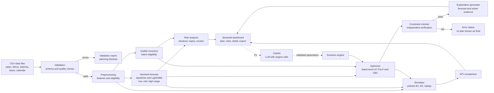

# Optiqo — AI-Powered Distribution Intelligence & Inventory Optimization Engine

**Product Requirements Document**

| | |
|---|---|
| **Event** | Triwizathon 2026 — Round 1 PRD Submission |
| **Team** | VYROX |
| **Challenge** | Problem Statement 2: Distribution Intelligence & Inventory Optimization Engine |
| **Version** | 1.0 |

**Terms used:** FMCG (fast-moving consumer goods); SKU (stock-keeping unit, one distinct product); FEFO (first-expired, first-out); LP (linear program); WAPE (weighted absolute percentage error); MAE (mean absolute error); KPI (key performance indicator); MVP (minimum viable product); LLM (large language model); CSV (comma-separated values).

---

## 1. Executive Summary

FMCG companies move products from warehouses to distributors and retail stores. In the same week, one location can run out of a product while another holds more than it can sell before the expiry date. Static rules such as "ship last month's average from the nearest warehouse" cannot prevent this: they treat each destination separately, ignore forecast uncertainty, and do not distinguish a fresh batch from one that will expire in transit.

**Optiqo** is a decision-support system that answers one question every dispatch cycle:

> **Which product, in what quantity, should be shipped from which warehouse batch to which destination, and why?**

Optiqo works in four stages:

1. **Forecast.** A LightGBM model, selected against two simple baselines on a validation window, predicts daily demand for every SKU–destination pair over the next 7 days. Validation errors are converted into a low / mid / high demand range.
2. **Optimize.** A linear program chooses how many units to ship from each eligible warehouse batch to each destination. It minimizes freight cost plus expected unmet-demand cost, expected expiry loss, and holding cost. Stock availability, minimum remaining shelf life, and storage capacity are hard constraints that are never traded away.
3. **Explain.** Every shipment line carries evidence taken from the forecast and the solver output: forecast demand, current stock, remaining shelf life at arrival, the cost of the next-best warehouse, and the binding constraints. A verifier recomputes every number in each explanation.
4. **Evaluate.** A day-by-day simulator replays held-out demand and compares Optiqo with two baseline policies on unmet demand, expiry wastage, freight cost, and total modeled cost. One baseline uses Optiqo's own forecast, so the benefit of better forecasting and the benefit of better allocation are measured separately.

Optiqo runs on CSV data. The demonstration dataset is simulated, and all generation rules and cost parameters are documented in `ASSUMPTIONS.md`.

---

## 2. Problem Statement

### 2.1 The problem

An FMCG company holds stock in several warehouses and must decide each dispatch cycle how to split limited stock across many destinations.

| Difficulty | Consequence |
|---|---|
| Demand differs by location and varies with weekday, promotions, and festivals | The same SKU is short in one city and in surplus in another |
| Warehouse stock is limited and shared by many destinations | A decision that is correct for one destination can starve another |
| Warehouses differ in distance, transit time, and freight cost | The nearest warehouse is not always the best source once stock and freshness are considered |
| Products expire and each batch has its own expiry date | Stock that arrives with too little remaining life is likely to be written off |

### 2.2 Why common approaches fall short

- **Average-based or par-level rules** under-stock on demand peaks and over-stock on troughs.
- **Point forecasts** hide risk. A forecast of 100 units with a plausible range of 70–140 needs a different buffer than the same forecast with a range of 95–105.
- **Per-destination decisions** each claim what they need and ignore competition for the same warehouse stock.
- **Warehouse-level expiry flags** do not show whether a specific batch will still be sellable by the time it arrives and is sold.

### 2.3 Traceability to the official requirements

The official statement asks for a system that analyzes available inventory, estimated demand, and distribution constraints to recommend which products go to which locations, in what quantities, and from which warehouses, minimizing stockouts, unnecessary transportation cost, and wastage while making the best use of available stock. Public or simulated data is allowed, with assumptions stated.

| ID | Official requirement | Optiqo feature | Component | Acceptance criterion |
|---|---|---|---|---|
| R1 | Analyze available inventory | Batch-level usable-stock calculation with shelf-life eligibility (P0-03) | Eligibility engine | No ineligible batch appears in any plan (O1 = 0) |
| R2 | Analyze estimated demand | Demand forecast with baselines and fallbacks (P0-04) | Forecast module | Daily and weekly WAPE reported against both baselines (F1, F2); each fallback path tested |
| R3 | Analyze distribution constraints | Stock, shelf-life, storage-capacity, and lane constraints (P0-05, P0-06) | Optimizer and independent checker | Checker finds 0 violations in all backtest plans |
| R4 | Recommend which products, to which locations, in what quantities, from which warehouses | Batch-level shipment plan and export (P0-05, P0-11) | Optimizer, CSV export | Every line states warehouse, batch, SKU, destination, quantity |
| R5 | Minimize stockouts | Shortage cost in the objective; K1 and K3 | Optimizer, simulator | K1 and K3 measured against B1 and B2 |
| R6 | Minimize unnecessary transportation cost | Freight cost in the objective; K5 | Optimizer, simulator | K5 measured against B1 and B2 |
| R7 | Minimize inventory wastage | Expiry-loss term, eligibility rule; K4 | Optimizer, simulator | K4 measured against B1 and B2 |
| R8 | Make the best possible use of available stock | Joint allocation across destinations; supply-bound versus allocation-caused shortage (O5) | Optimizer | O5 reports the share of unmet demand that no allocation could have avoided |
| R9 | Use demand forecasting, inventory optimization, or other intelligent decision-making | LightGBM forecasting, LP optimization, verified explanations | Forecast, optimizer, explainer | Forecast values enter the optimizer through horizon demand (8.2, 10.3) |
| R10 | Demonstrate how decisions improve supply-chain efficiency | Rolling backtest against two baselines | Simulator, dashboard | Identical demand, stock, and constraints for all policies; results reported in full |
| R11 | State assumptions; public or simulated data allowed | Documented synthetic dataset | Generator, `ASSUMPTIONS.md` | Every generation rule and cost parameter is listed |

The challenge title calls for an AI-powered engine. In Optiqo, machine learning provides the demand forecast. The allocation decision is made by mathematical optimization, which is a decision-intelligence technique rather than machine learning. The two are kept separate so each can be tested on its own (8.1).

### 2.4 Out of scope

Production planning and procurement, vehicle routing, price optimization, transfers between destinations, live ERP or warehouse-system integration, and supply tiers above the warehouse.

---

## 3. User Personas

| Persona | Responsibilities | Needs from Optiqo | Journeys |
|---|---|---|---|
| **Supply Chain Planner** (primary) | Builds the weekly dispatch plan across warehouses and destinations | A plan generated quickly, inspectable line by line, and exportable | J1–J7 |
| **Warehouse Manager** | Controls physical stock, picks batches, dispatches orders | Batch-level pick information ordered by expiry; early sight of batches nearing expiry | J2, J7 |
| **Regional Sales Manager** | Responsible for availability and service level in a region | A ranked list of SKU–destination pairs at risk of running out, with reasons | J2, J4 |
| **Operations / Finance Manager** | Responsible for logistics cost, write-offs, and planning quality | Measured comparison of the plan against baselines, split into cost components | J5, J6 |

---

## 4. Core User Journeys

**J1 — Load and validate the dataset** (Planner)
- *Goal:* start from data that is safe to plan with.
- *Actions:* select the demo dataset (P1: upload own CSVs) and click **Validate**.
- *System response:* a validation report lists errors (planning blocked) and warnings (planning allowed) with table, row, field, and rule.
- *Success:* the planner sees either "valid" or a precise list of what must be fixed; no plan runs on data with errors.
- *Requirements:* P0-01, P0-02, P0-12.

**J2 — Review inventory and demand risks** (Planner, Sales Manager, Warehouse Manager)
- *Goal:* know where problems are before dispatching.
- *Actions:* open **Risk Overview**; filter by region, SKU, or severity.
- *System response:* a ranked table of SKU–destination pairs with days of cover, expected unmet demand, expected expiry loss, and the factors behind each flag. Network-level supply shortages are listed separately.
- *Success:* every flag shows its numeric drivers; ranking follows one documented rule.
- *Requirements:* P0-03, P0-04, P0-07.

**J3 — Generate an allocation plan** (Planner)
- *Goal:* obtain a feasible dispatch plan for the next cycle.
- *Actions:* choose the dispatch date and click **Generate Plan**.
- *System response:* runs forecast, optimizer, and constraint check, then shows plan lines (warehouse, batch, SKU, destination, quantity, arrival date, remaining life at arrival, freight cost) and expected unmet demand, expiry loss, and freight cost before and after the plan.
- *Success:* status is OK and the independent checker reports zero violations; otherwise a defined error status is shown (P0-12).
- *Requirements:* P0-04, P0-05, P0-06, P0-10.

**J4 — Inspect why a recommendation was made** (Planner, Sales Manager)
- *Goal:* decide whether to trust a line.
- *Actions:* click a plan line.
- *System response:* shows the forecast and its range, current and inbound stock, selected quantity, remaining shelf life at arrival against the SKU minimum, the cost of the next-best eligible warehouse, and binding constraints, with a one-sentence explanation built from those fields.
- *Success:* every number in the explanation traces to a field in the plan or forecast table.
- *Requirements:* P0-08.

**J5 — Compare the plan with the baselines** (Operations/Finance Manager, Planner)
- *Goal:* see whether the plan beats the current method and where the gain comes from.
- *Actions:* open **Backtest** and run the default evaluation window.
- *System response:* replays the window day by day for B1, B2, and Optiqo; shows KPIs side by side with absolute and relative differences, the B1→B2 (forecast) and B2→Optiqo (allocation) contributions, and daily charts.
- *Success:* results are reproducible with the same seed and the run states seed, parameters, and software versions.
- *Requirements:* P0-09, P0-10.

**J6 — Run a what-if scenario** (Planner, Finance Manager; P1)
- *Goal:* test the plan under a changed situation.
- *Actions:* set scenario parameters (for example demand +20% in one region, a blocked lane, warehouse stock −30%), or state the request to the copilot and confirm the proposed parameters.
- *System response:* re-runs the same engine with the changed inputs and shows plan and KPI differences against the current plan.
- *Success:* parameters are validated; results come from the deterministic engine.
- *Requirements:* P1-01, P1-07.

**J7 — Export a dispatch plan** (Planner, Warehouse Manager)
- *Goal:* hand the plan to the warehouses.
- *Actions:* click **Export CSV** (P1: per-warehouse pick list).
- *System response:* downloads one row per shipment line including batch ID and expiry date.
- *Success:* exported quantities equal the on-screen plan and no line exceeds batch stock.
- *Requirements:* P0-11, P1-05.

---

## 5. Functional Requirements and Feature Prioritization

### 5.1 P0 — Must have (MVP)

| ID | Requirement | Rationale | Depends on | Acceptance criteria |
|---|---|---|---|---|
| P0-01 | **Reproducible demo dataset.** A seeded generator produces sales history, SKUs, warehouses, destinations, batch-level inventory with expiry dates, lanes with distance, transit time and freight cost, and a calendar of promotions and festivals. Rules are documented in `ASSUMPTIONS.md`. | Official statement allows simulated data with stated assumptions | — | The same seed yields byte-identical CSVs; default dataset has 4 warehouses, 40 destinations, 30 SKUs, 420 days; `ASSUMPTIONS.md` lists every rule and parameter |
| P0-02 | **Data validation.** Detects missing files and columns, missing values, negative or non-numeric quantities, invalid dates, duplicate keys, unknown SKU/warehouse/destination identifiers, expired batches, non-positive capacity or unit volume, and transit days below 1. | Bad data otherwise produces plausible but wrong plans | P0-01 | All 13 fault types are detected in seeded fault-injection tests; the clean dataset produces 0 errors; each finding names table, row, field, and rule |
| P0-03 | **Usable-inventory analysis.** For each warehouse batch and lane: arrival date, remaining life at arrival, and eligibility (remaining life at arrival ≥ SKU minimum). Reports usable versus unusable stock. | Stock that cannot be shipped or sold must not count as available | P0-02 | Hand-computed unit tests pass; usable plus unusable equals total on-hand; the rule is visible in the UI |
| P0-04 | **Demand forecasting.** Daily forecast per SKU–destination for 7 days. Baselines: seasonal-naive and 28-day moving average. ML: LightGBM with direct multi-step features. Per forecast group, the method with the lower validation WAPE is used. Low / mid / high multipliers come from validation residuals. Fallbacks in 10.4. | The demand estimate is a core input of the allocation | P0-02 | Leakage test passes (no feature uses data after the forecast origin); method choice recorded per row; every fallback path has a passing test |
| P0-05 | **Distribution optimizer.** Batch-level LP outputting warehouse, batch, SKU, destination, and quantity, minimizing the objective in 10.5. | Core product behavior | P0-03, P0-04 | Plan produced for the default dataset within O4; hand-solved test instances reproduce the expected allocation |
| P0-06 | **Hard-constraint validation.** An independent checker, separate from the solver, verifies batch availability, eligibility, storage capacity, blocked lanes, and non-negative whole-unit quantities for every plan. | A solver or rounding error must not produce an invalid plan | P0-05 | 0 violations across all backtest plans; deliberately corrupted plans are rejected |
| P0-07 | **Risk and exception view.** Ranked SKU–destination alerts for stockout, expiry, and excess, plus network-level supply shortages, using the formulas in 10.6. | Planners need to see problems, not only a plan | P0-03, P0-04 | Each alert shows its factors; ranking is deterministic; values recompute from the exported table |
| P0-08 | **Evidence-based explanations.** Each plan line carries an evidence record and a template-built sentence (10.9). | Official goal: decisions must be understandable | P0-05 | 100% of lines have an explanation; the verifier recomputes every number and finds 0 mismatches |
| P0-09 | **Baselines and comparison.** B1 and B2 (10.7) and the simulator (10.8) produce a KPI comparison on identical inputs, including the decomposition into forecast effect and allocation effect. | Efficiency claims must be measured | P0-04, P0-05 | All policies share starting stock, demand, replenishment, costs, and eligibility rules; the result table is identical across two runs |
| P0-10 | **Dashboard.** Streamlit pages: Data & Validation, Risk Overview, Plan, Recommendation Detail, Backtest. | Demonstrable end-to-end workflow | P0-02 to P0-09 | J1–J5 run end to end on the demo dataset |
| P0-11 | **CSV export of the plan.** | Actionable output | P0-05 | Row count and quantities equal the displayed plan; cells beginning with `=`, `+`, `-`, or `@` are neutralized |
| P0-12 | **Failure handling.** Defined statuses for invalid data, forecast failure, solver timeout or non-optimal status, infeasibility, and missing files. No invalid plan is shown as final. | Honest behavior under failure | All | Each injected failure produces its documented status and message without a crash; fallback outputs are labeled "not optimized" |

### 5.2 P1 — Should have

| ID | Requirement | Rationale | Depends on | Acceptance criteria |
|---|---|---|---|---|
| P1-01 | **What-if scenarios.** Parameters: demand multiplier (by region, category, or SKU), warehouse stock multiplier, blocked lanes, freight cost multiplier. | Shows the consequences of changed conditions | P0-05, P0-09 | Parameters validated against a schema; plan and KPI differences shown against the base plan; identical input gives identical output |
| P1-02 | **Alternative-plan comparison.** Compare Optiqo's plan with B1/B2 plans and with a plan under different penalty settings, by line and by KPI. | Supports "why this and not that" | P0-05, P0-09 | Side-by-side view with per-destination and KPI differences |
| P1-03 | **Planner override and audit trail.** Edit a quantity or block a lane with a reason; each change is logged with original line, new value, reason, and KPI difference. | Human review of decisions | P0-06 | Edited plan passes the checker or is rejected with the violated constraint; log has all fields |
| P1-04 | **Early-warning ranking** of SKU–destination pairs most likely to be short in the next two cycles if no action is taken. | Gives sales managers advance notice | P0-07 | Uses the 10.6 formulas on the next two cycles; shown with drivers |
| P1-05 | **Warehouse pick and dispatch lists** per warehouse and batch, sorted by expiry. | Warehouse use | P0-11 | Totals equal plan totals |
| P1-06 | **CSV upload with validation report.** | Lets users test their own data | P0-02 | Files over 10 MB, wrong columns, or non-CSV content are rejected with a message; uploaded content is never executed |
| P1-07 | **Constrained copilot (optional LLM).** Answers questions about risks, plan lines, and baseline comparison through calls to engine functions; converts scenario requests into validated parameters and asks for confirmation before running (8.5). | Easier access for non-technical users | P0-08, P1-01 | With the LLM disabled, every other feature works unchanged |
| P1-08 | **Plain-language plan summary** built from templates over the KPI table. | Quick read for managers | P0-09 | Every number matches the KPI table |
| P1-09 | **Case-pack and truck constraints.** Integer case packs; truck-count variables with capacity and fixed cost. | More realistic freight | P0-05 | Quantities are multiples of case size; truck capacity respected |

### 5.3 P2 — Future enhancements (not part of the MVP)

SHAP-based forecast explanations; interactive map of warehouses and flows; supply tiers above the warehouse; automatic tuning of cost parameters; additional forecasting models; quantile forecasting models; transfers between destinations; REST API wrapper; integration with real ERP and warehouse systems.

---

## 6. High-Level System Architecture and Data Flow

### 6.1 Design

Optiqo is a single Python application. A core library implements validation, forecasting, optimization, risk analysis, explanation, and simulation. A Streamlit app calls the library in-process; no separate HTTP service is used in the MVP. The library exposes typed functions (6.5), so a REST wrapper (P2) can be added without changing the engine.

### 6.2 Technology stack

| Layer | Choice | Purpose |
|---|---|---|
| Language | Python 3.11 | Data, ML, optimization, and UI in one language |
| Data storage | CSV files read with pandas; run outputs saved as CSV and JSON | No database server; inspectable inputs and outputs |
| Forecasting | LightGBM (Tweedie objective) and pandas baselines | Non-negative, count-like demand |
| Optimization | PuLP with the CBC solver | Open-source LP |
| Interface | Streamlit with Plotly | Interactive pages |
| Schemas | pydantic | Typed results; scenario-parameter validation |
| Optional LLM | One LLM API with tool calling | P1 copilot only; never in the decision path |
| Tests | pytest | Constraints, leakage, validation, explanations |

### 6.3 Architecture diagram



### 6.4 Components

| Component | Role | Output |
|---|---|---|
| Validation | Checks schema and data quality before anything runs | `ValidationReport` (errors, warnings) |
| Preprocessing | Builds features and computes batch eligibility per lane | Feature table, eligibility table |
| Forecast module | Daily forecasts and demand range for 7 days | `ForecastTable` with method per row |
| Risk analysis | Expected unmet demand, expiry loss, excess, days of cover | `RiskTable` |
| Optimizer | Shipment quantities per batch and destination | `Plan` with status and lines |
| Constraint checker | Re-verifies every hard constraint from scratch | Pass/fail list naming violated rules |
| Explanation generator | Evidence record and sentence per line | Explanation fields in the plan |
| Simulator | Replays days with realized demand under each policy | Daily logs, KPI table |
| Dashboard | Plan, risks, detail, comparison, export | Streamlit pages |
| Copilot (P1) | Translates questions and scenario requests into engine calls | Text answers referencing engine output |

### 6.5 Core library interface

| Function | Purpose | Inputs | Outputs | Validation and errors |
|---|---|---|---|---|
| `validate_dataset(path)` | Check schema and quality | Folder of CSVs | `ValidationReport` | Missing or malformed files give `ERROR_DATA` naming the file |
| `build_forecast(data, origin_date, horizon=7)` | Forecast demand and range | Validated data, dispatch date | `ForecastTable` | Short history or model failure triggers fallback and `FALLBACK_FORECAST` for those rows |
| `analyze_risk(data, forecast, origin_date)` | Risk flags and ranking | Data, forecast | `RiskTable` | Missing forecasts are reported, not filled silently |
| `generate_plan(data, forecast, params)` | Optimize and verify | Data, forecast, cost parameters | `Plan` (status, lines, evidence, summary) | `OK`, `SOLVER_TIMEOUT`, `SOLVER_NOT_OPTIMAL`, `INFEASIBLE`, `CHECK_FAILED`, `ERROR_DATA` |
| `run_backtest(config)` | Compare policies over a window | Dataset, seed, window | `BacktestResult` | Same seed gives identical results |
| `run_scenario(plan_id, params)` (P1) | What-if analysis | Validated parameters | `ScenarioResult` | Out-of-range parameters rejected with a message |

### 6.6 Results and errors in the interface

Each function returns an object with a `status` and a list of human-readable `messages`. The dashboard maps status to a banner: green (OK), yellow (OK with warnings or fallback), red (no valid plan). A red status never presents a plan as final. A fallback baseline plan, if offered after a failure, is labeled "not optimized" and passes the same constraint checker.

### 6.7 Caching and run records

Forecasts are cached by a hash of the dataset, origin date, and configuration. Each run writes a manifest with dataset hash, seed, parameters, library versions, and timestamp.

---

## 7. Success Metrics and Measurable KPIs

### 7.1 Measurement rules

1. Numeric targets are acceptance thresholds for the evaluation on simulated data. Measured values are reported in full whether or not a threshold is met.
2. Results depend on data characteristics, cost parameters, stock availability, and baseline settings; the sensitivity study (E4, 16.1) quantifies this.
3. All policies are compared on the same demand realization, starting stock, warehouse replenishment, cost parameters, and hard constraints.
4. Baseline parameters are fixed before the experiments and are not tuned against Optiqo's results.
5. Results are reported as the mean and the range (minimum to maximum) over 5 datasets generated with different seeds. No statistical-significance claim is made.
6. **Absolute versus relative change.** If unmet demand falls from 5.0% to 3.5%, the absolute change is 1.5 percentage points and the relative reduction is 30%. Every reported change states which one it is.
7. The evaluation window is 56 days (8 weekly dispatch cycles). KPIs are network-wide over the window unless stated, with breakdowns per SKU, destination, and day.

### 7.2 Business outcome KPIs (simulator)

| ID | KPI | Definition | Target |
|---|---|---|---|
| K1 | Unmet-demand rate | Unmet units ÷ demanded units | Relative reduction ≥ 30% versus B1 and ≥ 10% versus B2 |
| K2 | Fill rate | 1 − K1 | ≥ 95% on the default dataset, whose supply is designed to cover at least 97% of demand (11.3) |
| K3 | Stockout-day rate | SKU–destination–days with unmet demand ÷ SKU–destination–days with positive demand | Relative reduction ≥ 25% versus B1 |
| K4 | Expiry wastage | Units expired unsold; the same in currency at landed unit cost; and as a share of units received | Relative reduction ≥ 40% versus B1 |
| K5 | Freight cost | Total freight cost, and freight cost per shipped unit | Per-unit cost lower than B1 by ≥ 10%; total reported even if higher |
| K6 | Total modeled cost | Freight + holding + expired stock at landed cost + lost margin on unmet demand (reporting uses margin only, without the optimizer's goodwill factor) | Relative reduction ≥ 15% versus B1 |
| K7 | Ending inventory | Units, value, and days of cover at the end of the window | Not more than 10% above B1, so service is not bought with excess stock |
| K8 | Gain decomposition | For K1, K4, and K6: change from B1 to B2 (forecast effect) and from B2 to Optiqo (allocation effect) | Reported |

### 7.3 Forecast quality KPIs

| ID | KPI | Definition | Target |
|---|---|---|---|
| F1 | WAPE, daily | Σ absolute error ÷ Σ actual, per SKU–destination–day | Reported for all three methods on the evaluation window |
| F2 | WAPE, weekly | Same, on 7-day totals | Selected method ≤ best single baseline at network level |
| F3 | MAE | Mean absolute error in units | Reported |
| F4 | Bias | (Σ forecast − Σ actual) ÷ Σ actual | Absolute value ≤ 5% at network level |
| F5 | Interval coverage | Share of 7-day actuals between the low and high scenarios (nominal 80%) | Between 70% and 90% |

### 7.4 Optimization quality KPIs

| ID | KPI | Definition | Target |
|---|---|---|---|
| O1 | Hard-constraint violations | Count from the independent checker over all plans | 0 |
| O2 | Feasible-plan rate | Plans with status OK and O1 = 0 ÷ plans generated (5 seeds × 8 cycles) | 100% |
| O3 | Grounded explanations | Lines whose explanation numbers all recompute ÷ all lines | 100% |
| O4 | Optimizer runtime | Seconds per plan, 95th percentile over backtest cycles on the reference configuration | ≤ 60 s |
| O5 | Supply-bound shortage | Unmet units unavoidable because usable network stock is below demand (Σ over SKUs of max(0, expected demand − usable network stock)), reported apart from allocation-caused unmet units | Reported |

### 7.5 System quality KPIs

| ID | KPI | Definition | Target |
|---|---|---|---|
| S1 | End-to-end planning runtime | Load, validate, forecast, optimize, check, explain for one cycle | ≤ 120 s on the reference configuration |
| S2 | Reproducibility | Same seed and inputs give identical plan CSV and KPI table | Identical |
| S3 | Validation accuracy | Injected faults detected ÷ injected faults; false errors on the clean dataset | 100% detected; 0 false errors |
| S4 | Graceful failure | Injected failures (solver timeout, missing file, forecast failure, LLM unavailable) ending in a defined status without a crash | 100% |

The reference configuration is the machine used for evaluation; the test report records its CPU, memory, and software versions.

---

## 8. Proposed Solution and Core Decision Workflow

### 8.1 Roles of each layer

| Layer | Method | Decides | Does not decide |
|---|---|---|---|
| Forecasting | Gradient-boosted trees checked against baselines | Expected demand and its range | Shipment quantities |
| Optimization | Linear programming | Quantities, sources, destinations | Demand levels |
| Explanation | Deterministic templates over computed fields | How the plan is described | Anything in the plan |
| Copilot (optional) | LLM calling engine functions | How users pose questions | Allocations, constraints, or numbers |

### 8.2 Decision workflow for one dispatch cycle

1. **Load and validate** data as of dispatch date *t0*.
2. **Compute usable inventory.** For each warehouse batch and lane: arrival date = *t0* + transit days; remaining life at arrival = expiry date − arrival date; the batch is eligible for the lane only if remaining life at arrival ≥ the SKU's minimum.
3. **Forecast** daily demand for days *t0*+1 to *t0*+7 per SKU–destination using only data up to *t0*, and convert to low / mid / high horizon demand.
4. **Analyze risk** on current stock with no new shipments, to show what happens if nothing is done.
5. **Optimize** the batch-level allocation. The forecast enters through horizon demand and through cumulative demand at each lot's expiry day (10.3).
6. **Verify** with the independent checker; reject invalid plans.
7. **Explain** each line and recompute risk after the plan to show the expected change.
8. **Present** on the dashboard and **export** on request.
9. **Evaluate** in the simulator against B1 and B2.

### 8.3 Why joint allocation

Warehouse stock is shared. If each destination asks for its own forecast need, the requests can exceed supply, and a rule such as proportional cut-back ignores that a unit has different value at different places: lost margin avoided, freight cost, and remaining shelf life all differ. Solving all destinations together places scarce units where the combined cost is lowest. Whether a batch is fully allocated or a destination's capacity is binding is read from the solution's slack values and shown as evidence.

### 8.4 Risk detection

Risk is computed with the same demand scenarios and lot logic as the optimizer (10.6), so risk numbers and plan numbers are consistent. Each alert lists its inputs, and alerts are ranked by one fixed rule.

### 8.5 Optional AI copilot (P1)

- **Scope:** answers questions about risks, a specific plan line, a warehouse choice, expiry exposure, and the baseline comparison; translates scenario requests into parameters.
- **Mechanism:** the LLM can only call named engine functions (get risk table, get plan line, get KPI table, run scenario). It cannot write plan lines or change constraints.
- **Scenario flow:** the user states a request; the copilot proposes validated parameters (for example `{"region": "West", "demand_multiplier": 1.2}`); the app shows them for confirmation; the deterministic scenario engine runs; the copilot summarizes the returned table.
- **Number check:** every figure in an answer is compared with the engine output; on any mismatch the app shows the raw engine output instead.
- **Fallback:** if the LLM is unavailable or disabled, the copilot panel is hidden and all other features, including the form-based what-if panel, keep working.
- **Labeling:** generated text is marked as a description of engine output.

### 8.6 Human review and audit trail

P0 provides inspection and export. Overrides with a recorded reason and KPI difference are P1 (P1-03).

---

## 9. Innovation and Differentiation

Forecasting, optimization, expiry-aware inventory control, and explainable analytics are established fields. Optiqo's differentiation lies in how these are combined and verified in one reproducible prototype.

| Dimension | Baseline policy (B1) | Optiqo | Measured by |
|---|---|---|---|
| Demand input | 7-day trailing average times cover days | Forecast selected against baselines on a validation window, with a low / mid / high range | F1–F5, K1 |
| Allocation | Each destination served up to its target from the nearest warehouse; proportional cut-back when short | Joint optimization across all destinations sharing stock | K1, K3, K5, K6 |
| Shelf life | Same eligibility rule as Optiqo, oldest eligible batch first | Eligibility plus expected expiry loss inside the objective, using lot-by-lot expiry logic at the destination | K4 |
| Uncertainty | Fixed safety days | Demand scenarios from validation residuals, checked for coverage | F5, K1, K4, K7 |
| Explanation | None | Per-line evidence from computed fields, verified by recomputation | O3 |
| Source of gains | Not separable | B2 uses Optiqo's forecast with simple allocation, which separates forecast effect from allocation effect | K8 |
| Shortage diagnosis | Not available | Splits unmet demand into supply-bound (unavoidable) and allocation-caused | O5 |
| Plan safety | Not checked independently | Independent checker re-verifies every hard constraint | O1, O2 |
| Evaluation | Not applicable | Leakage-safe, day-by-day replay with identical inputs for every policy | K1–K8 |
| Scenario analysis (P1) | Manual spreadsheet edits | Validated parameters re-run through the same engine | P1-01 |

---

## 10. Optimization Logic, Constraints, and Decision Rules

### 10.1 Planning cycle and horizon

- Dispatch occurs every 7 days at the end of day *t0*, using data through *t0*.
- Horizon *H* = 7 days: the plan targets demand on days *t0*+1 to *t0*+*H*.
- Transit time per lane is 1–3 days and fixed.
- Unmet demand is lost, not backordered. There is no substitution between SKUs.

### 10.2 Sets, inputs, and decision variables

**Sets**
- *W* warehouses; *L* destinations (distributors and retail stores); *S* SKUs.
- *B* warehouse batches. Batch *b* belongs to one warehouse *w(b)* and one SKU *s(b)*.
- *K* demand scenarios: low, mid, high.
- For each destination–SKU (*l*, *s*): the existing lots at the destination, including stock already in transit, each with a quantity and expiry date.

**Inputs**
- *Q_b* quantity and *e_b* expiry date of batch *b*.
- *τ(w,l)* transit days; *blocked(w,l)* lane flag.
- *m_s* minimum remaining life at delivery (days) for SKU *s*.
- *f(l,s,d)* forecast mean demand for day *d* = 1..*H*.
- *μ_k(l,s)* demand multiplier for scenario *k* (10.4); *π_k* scenario weight.
- Costs: freight rate per unit of volume per lane; shortage penalty *p_s*; waste cost *v_s* (landed unit cost); holding cost *h_s* per unit left at the end of the horizon.
- *vol_s* volume per unit; *capRoom(l)* = max(0, storage capacity − volume of current and inbound stock) at destination *l*.

**Derived values**
- Remaining life at arrival of batch *b* shipped to *l*: *r(b,l)* = *e_b* − (*t0* + *τ(w(b),l)*).
- A pair (*b*, *l*) is **eligible** if *r(b,l)* ≥ *m_{s(b)}*, the lane is not blocked, and *Q_b* > 0. Only eligible pairs get a decision variable. This is a hard rule.
- Expiry day index of a lot: *n* = expiry date − *t0*.
- Cumulative scenario demand by day *n*: *D_k(l,s,n)* = *μ_k(l,s)* × Σ over *d* = 1..min(*n*, *H*) of *f(l,s,d)*. Horizon demand is *D_k(l,s,H)*.

**Decision variable**
- *x(b,l)* ≥ 0: units of batch *b* shipped to destination *l*.

**Auxiliary variables (per destination, SKU, scenario)**
- *short(l,s,k)* unmet demand; *waste(l,s,k)* units expiring unsold within the horizon; *end(l,s,k)* units left at the end of the horizon; *wc(l,s,k,j)* cumulative expired units after the *j*-th lot (10.3). All are ≥ 0.

### 10.3 Expiry logic at the destination (lot by lot)

For each destination–SKU, the lots after shipping are the existing lots plus every shipped batch portion. Sort them by expiry day *n_1* ≤ *n_2* ≤ … Let *S_j* be the cumulative quantity of lots 1..*j*. Eligibility is a known property of each (*b*, *l*) pair, so the sort order does not depend on the decision variable; only quantities do, and *S_j* is linear in *x*.

If the destination sells oldest stock first, units in lots 1..*j* can only be sold by day *n_j*, so at least *S_j* − *D_k(l,s,n_j)* of them expire unsold. For lots with *n_j* ≤ *H*:

```
wc(j) >= S_j - D_k(l,s,n_j)
wc(j) >= wc(j-1)            with wc(0) = 0
waste(l,s,k) = wc(J*)       where J* is the last lot with n_j <= H
```

If no lot expires inside the horizon, *waste* is 0. Expiry is therefore a cost the optimizer weighs, not only a flag.

Unmet demand and ending stock follow from the units that survive:

```
short(l,s,k) >= D_k(l,s,H) - (S_total - waste(l,s,k))
end(l,s,k)   >= (S_total - waste(l,s,k)) - D_k(l,s,H) + short(l,s,k)
```

**Model approximation.** The LP treats all destination stock as available from day 1 of the horizon and does not delay shipments by their 1–3 transit days. The simulator applies exact timing, so any resulting optimism is visible in the measured KPIs.

### 10.4 Demand scenarios, calibration, and fallbacks

The three scenarios are a coarse discretization of horizon demand, not exact probabilities.

1. **Data split.** Days 1–280 train the model, days 281–364 form the validation window (12 weekly forecast origins), days 365–420 form the evaluation window. After method selection, the chosen ML model is refit on days 1–364 with the same settings and is not retrained during the evaluation window.
2. **Method selection.** For each forecast group (category × volume tier), the method with the lowest validation weekly WAPE is used among seasonal-naive, 28-day moving average, and LightGBM.
3. **Multipliers.** On the validation window, compute the ratio of 7-day actual to 7-day forecast for each SKU–destination and week. *μ_low*, *μ_mid*, *μ_high* are its empirical 10th, 50th, and 90th percentiles. Groups with fewer than 100 observations use the pooled distribution of their category.
4. **Weights.** Default *π* = (0.3, 0.4, 0.3). A diagnostic compares the weighted scenario mean with the mean validation ratio; if the bias exceeds 5%, the outer weight *p* (with the mid weight 1 − 2*p*, limited to 0.15 ≤ *p* ≤ 0.35) is set so the weighted mean matches the validation mean.
5. **Calibration check.** F5 reports how often 7-day actuals on the evaluation window fall between *μ_low* and *μ_high*.

**Limitations.** The ratio is unstable for very slow-moving items with near-zero weekly totals; pooled multipliers can misstate uncertainty for individual destinations; three scenarios cannot represent a heavy tail. Multipliers are applied to partial-horizon cumulative demand as well as to the full horizon.

**Forecast fallbacks (P0-04, P0-12)**

| Situation | Rule | Status |
|---|---|---|
| Series has fewer than 56 days of history | Average weekday profile of the same category and region, scaled by the destination's size factor | `FALLBACK_FORECAST` for those rows |
| LightGBM training or prediction raises an error | Better of seasonal-naive and 28-day moving average for all rows | `FALLBACK_FORECAST` |
| ML validation WAPE is not lower than the best baseline for a group | Baseline used for that group | Method recorded per row |
| Missing recent sales days | Fill from the same-weekday median of the last four weeks and flag the rows | Validation warning |
| Forecast missing or negative after prediction | Clip negatives to 0; if missing, use the baseline and flag | `FALLBACK_FORECAST` |

**Forecast features (leakage-safe).** Same-weekday sales from previous weeks (lag of 7 days or more relative to the target date), rolling mean and standard deviation of the last 7 and 28 days up to *t0*, target weekday, forecast step *d*, promotion and festival flags and planned price for the target date, category, region, and destination size.

### 10.5 Objective and constraints

**Objective (minimize)**

```
sum over eligible (b,l):  freight(w(b),l) * vol(s(b)) * x(b,l)
+ sum over (l,s,k):  pi_k * ( p_s * short(l,s,k) + v_s * waste(l,s,k) + h_s * end(l,s,k) )
```

Shortage, waste, and holding are **soft penalties**. Their parameters set the trade-off between service, wastage, and freight. They never override a hard constraint.

**Hard constraints**

| ID | Constraint | Meaning |
|---|---|---|
| C1 | Σ over *l* of *x(b,l)* ≤ *Q_b* for each batch *b* | Cannot ship more than a batch holds |
| C2 | Variables exist only for eligible (*b*, *l*) pairs | Minimum remaining shelf life and blocked lanes respected |
| C3 | Σ over *s* of *vol_s* × (Σ over batches of SKU *s* of *x(b,l)*) ≤ *capRoom(l)* for each *l* | Destination storage capacity |
| C4 | *x* and auxiliary variables ≥ 0; final quantities are whole units | No fractional or negative shipments |
| C5 | Each destination considers at most the 3 lowest-freight warehouses holding eligible stock of that SKU | Controls model size; validated against the full model on a small instance (E2) |

**Rounding.** The LP is continuous. Quantities are rounded down to whole units, which cannot violate C1–C3. Rounding loss is at most one unit per line and is reported.

**Infeasibility.** In the P0 formulation, *x* = 0 satisfies every hard constraint, so the model is always feasible; insufficient supply appears as unmet demand. Infeasibility can arise only in P1 features (forced overrides, case-pack or truck rules). The engine then returns `INFEASIBLE`, relaxes the forced items one group at a time to identify the conflicting group, shows it to the user, and outputs no plan. Other non-optimal solver states (`SOLVER_TIMEOUT`, `SOLVER_NOT_OPTIMAL`) also prevent a plan from being shown as final; a time-limited best solution is shown only if it passes the checker and is labeled "time-limited, not proven optimal".

**Scope of the P0 model.** Truck-count variables, case-pack integrality, and minimum shipment sizes appear only in P1-09. P0 uses a per-unit freight cost linear in shipped volume.

### 10.6 Risk formulas

For each (*l*, *s*), using the lot logic of 10.3 with *x* = 0 (before the plan) and with the planned *x* (after):

| Measure | Formula | Unit |
|---|---|---|
| Expected unmet units | Σ over *k* of *π_k* × *short(l,s,k)* | units |
| Unmet share | Expected unmet ÷ expected demand | % |
| Days of cover | Usable on-hand ÷ mean daily forecast | days |
| Expected expiry loss | Σ over *k* of *π_k* × *waste(l,s,k)*, and × *v_s* in currency | units, currency |
| Excess units | max(0, expected end stock − 14 × mean daily forecast) | units |
| Financial exposure | Expected unmet × unit margin + expected expiry loss × *v_s* | currency |

**Severity (configurable defaults):** HIGH if unmet share ≥ 15% or expiry loss ≥ 15% of on-hand; MEDIUM if either is ≥ 5%; otherwise LOW. Alerts are ranked by financial exposure, with unmet share as tie-breaker. A separate **supply shortage** flag marks SKUs whose total usable network stock is below total expected demand.

### 10.7 Baseline policies

Both baselines use the same eligibility rule as Optiqo, the same lead times, and the same capacity limits.

- **B1 (conventional rule).** Target stock per destination = 7-day trailing average daily sales × (7 + 2 safety days). Order quantity = max(0, target − on-hand − inbound). Each destination is served from the nearest warehouse with eligible stock, taking the earliest-expiring eligible batch first. If a warehouse cannot cover all requests, its available stock is split in proportion to the requests.
- **B2 (same forecast, simple allocation).** Identical to B1, except the target uses Optiqo's mid-scenario forecast instead of the trailing average. B2 separates the gain from better forecasting from the gain from joint optimization.

The constants 7 and 2 are fixed before the experiments and varied in the sensitivity study (E4).

### 10.8 Simulator

The simulator runs repeated weekly planning over the 56-day evaluation window using the realized demand held out from training.

For each day, in order:
1. **Receipts.** Shipments arriving today become lots at the destination; warehouse replenishment batches (identical for all policies, defined in the dataset) arrive at warehouses.
2. **Expiry.** Lots with expiry date ≤ today are removed and counted as expired units and cost.
3. **Sales.** Realized demand is served from destination stock, oldest lot first; unserved demand is recorded as unmet.
4. **Dispatch (every 7th day).** The policy sees only data through today, creates shipments, deducts them from warehouse batches, and schedules arrivals; freight cost is recorded.
5. **Accounting.** Holding cost on ending stock; daily logs of inventory, sales, unmet demand, expiry, and cost.

**Leakage control.** Demand after the dispatch day is never visible to any policy or forecast. Calendar events and planned promotions for the next 7 days are treated as known at planning time and used as features; this is stated in `ASSUMPTIONS.md`.

### 10.9 Evidence in explanations

For every plan line the engine records: forecast mean and low / high horizon demand; current and inbound stock; shipped quantity; remaining life at arrival and the SKU minimum; freight cost of this lane and of the next-best eligible lane for the same quantity (computed, not estimated); whether the batch is fully allocated; whether destination capacity is binding; and expected unmet demand and expiry loss before and after. A sentence template fills these fields. A clause whose field is unavailable is omitted rather than estimated.

---

## 11. Data Requirements, Data Quality, and Assumptions

### 11.1 Tables and mandatory fields

| Table | Key | Mandatory fields | Optional fields |
|---|---|---|---|
| `skus` | `sku_id` | name, category, shelf_life_days, min_life_days, unit_volume, unit_cost, unit_margin | case_size |
| `warehouses` | `warehouse_id` | name, region | capacity |
| `destinations` | `dest_id` | name, type (distributor or store), region, storage_capacity | size tier |
| `lanes` | `warehouse_id`, `dest_id` | distance_km, transit_days, freight_rate | blocked flag, truck capacity, truck fixed cost |
| `sales_daily` | `date`, `dest_id`, `sku_id` | units_sold | price, promo_flag |
| `inventory_batches` | `location_id`, `sku_id`, `batch_id` | location_type (warehouse or destination), quantity, expiry_date | received_date |
| `inbound_shipments` | `shipment_id` | dest_id, sku_id, batch_id, quantity, arrival_date, expiry_date | — |
| `warehouse_receipts` | `receipt_id` | warehouse_id, sku_id, batch_id, quantity, arrival_date, expiry_date | — |
| `calendar_events` | `date` | festival_flag, promotion flags by SKU or category | weather index |
| `config` | — | shortage penalty factor, holding cost rate, horizon, baseline safety days | scenario weights |

`lanes`, `inventory_batches`, `sales_daily`, `inbound_shipments`, and `warehouse_receipts` reference `warehouses`, `destinations`, and `skus` by identifier. Validation rejects references to unknown identifiers.

### 11.2 Validation rules (P0-02)

**Errors (planning blocked):** missing required file or column; missing required value; non-numeric or negative quantity; invalid or unparsable date; duplicate key; unknown SKU, warehouse, or destination identifier; batch with expiry before the planning date (listed and excluded on user choice); non-positive storage capacity; non-positive unit volume; lane with transit days below 1. These are the 13 fault types used in the S3 tests.

**Warnings (planning allowed):** gaps in sales days (filled and flagged, 10.4); extreme demand outliers; destinations whose stock already exceeds capacity.

### 11.3 Simulated dataset design

The default dataset has 4 warehouses, 40 destinations (10 distributors and 30 stores across four regions), 30 SKUs in five categories with shelf lives from about 10 to 365 days, and 420 days of daily sales. Days 1–280 are for training, 281–364 for validation, and 365–420 for evaluation. All rules are seeded:

- **Base demand:** SKU base rate × destination size factor × regional factor.
- **Seasonality:** weekday profile by category; a slow annual cycle; a mild trend per SKU.
- **Events:** three festival windows per year and random 7-day promotions with uplift, recorded in `calendar_events`.
- **Noise:** negative-binomial noise; slow SKUs are intermittent.
- **Regional differences:** some categories sell more in some regions.
- **Inventory:** each warehouse holds several batches per SKU with different expiry dates; destination stock starts at about 3–10 days of cover.
- **Supply tightness:** warehouse replenishment is set so total usable network supply covers about 97–105% of expected demand across the window, with some SKUs and weeks tighter than others, so allocation choices matter.
- **Transport:** destinations and warehouses lie on a coordinate grid; distance = straight-line distance × 1.3; transit days (1–3) derive from distance; freight cost scales with distance and unit volume.
- **Costs:** unit cost, margin, and holding rate by category; shortage penalty = unit margin × 1.5; waste cost = unit landed cost; minimum remaining life at delivery = max(2, min(⌈0.35 × shelf life⌉, 45)) days.

The dataset is simulated and does not represent any company. Results derived from it are evaluation results on simulated data, not real-world savings.

### 11.4 Optional public data

The M5 retail data (Walmart unit sales) can be used to check the forecaster on real sales patterns. It contains no warehouse, batch, or transport information, so it does not replace the simulated dataset and is not required by the MVP.

### 11.5 Stated assumptions (documented in `ASSUMPTIONS.md`)

Unmet demand is lost. Planned promotions and calendar events are known one week ahead. Transit times are deterministic. Warehouse replenishment is exogenous and identical across policies. SKUs do not substitute for one another. Destinations sell oldest stock first. Cost parameters are plausible values, not measurements.

---

## 12. Research Review, Research Gap, and Proposed Contribution

### 12.1 Reviewed studies

| Study | Problem addressed | Method | Finding reported by the source | Relevance to Optiqo |
|---|---|---|---|---|
| Jauhar et al. (2025) | Demand forecasting for perishable products | Customer segmentation (k-means, hierarchical clustering), then per-segment forecasting with explainable AI; wine-industry setting | Hierarchical clustering with LSTM gave a lower weighted RMSE than unsegmented forecasting (61.57 versus 238.18); support vector regression outperformed autoregressive models | Supports explainable, perishable-aware forecasting; the scope is forecasting, not allocation across warehouses |
| De Bock et al. (2024) | Defining explainable AI for operational research | Framework of performance, attributable, and responsible analytics; review of methods; research agenda | Proposes the framework and agenda | Optiqo's explanations are attributable to the model's own outputs and verified by recomputation |
| Seyedan, Mafakheri and Wang (2023) | Linking demand forecasts to order-up-to inventory decisions | Ensemble deep-learning forecasts for online retail; safety stock from the forecast demand distribution under a cycle-service-level target | Ensemble learning can improve accuracy over single models; forecasts feed safety-stock decisions | Supports using the forecast distribution in stock decisions; the study concerns ordering, not allocation across destinations or shelf life |
| Geevers, van Hezewijk and Mes (2024) | Multi-echelon inventory control | Deep reinforcement learning (proximal policy optimization) on linear, divergent, and general network structures | PPO with a continuous action space consistently outperformed the benchmark solution | An alternative approach to inventory decisions; Optiqo uses LP so hard stock, shelf-life, and capacity constraints are enforced directly and checked independently |
| Liao, Peng and Rong (2026, preprint) | Perishable inventory with random lead times and unknown demand | Deep-learning policies that embed inventory-theory structure | Building in domain knowledge improves learning efficiency with limited data | Supports combining learning with domain structure, as Optiqo combines a learned forecaster with an optimization model |
| Makridakis, Spiliotis and Assimakopoulos (2022a) | Retail sales forecasting benchmark | M5 "Accuracy" competition on 42,840 hierarchical Walmart unit-sales series | Reports results and best-performing methods | Evaluation practice and a possible public dataset |
| Makridakis et al. (2022b) | Probabilistic forecasting benchmark | M5 "Uncertainty" competition | Reports results of the uncertainty challenge | Motivates checking interval calibration (F5) |

### 12.2 Research gap

The reviewed studies each address part of the distribution problem: perishable demand forecasting (Jauhar et al.), explainability requirements for analytics in operations (De Bock et al.), forecast-driven ordering (Seyedan et al.), learned inventory policies (Geevers et al.; Liao et al.), and forecast benchmarks including probabilistic evaluation (Makridakis et al.). As described in their abstracts, none of them combines, in one lightweight prototype that runs on plain CSV data:

1. forecast-informed demand ranges calibrated on a held-out window;
2. joint allocation of shared warehouse stock across competing destinations;
3. batch-level shelf-life eligibility with expected expiry loss inside the objective;
4. explanations tied to solver output and verified by recomputation; and
5. a leakage-safe comparison against two baselines that separates the forecast effect from the allocation effect.

This combination is the focus of Optiqo. The gap is a scoped one: it concerns this specific combination and its reproducible evaluation, not the individual techniques, which are established.

### 12.3 Contribution areas

1. A reproducible decision-support prototype on accessible CSV or simulated data.
2. Joint allocation across competing destinations driven by forecast-informed demand ranges.
3. Lot-by-lot expiry logic that values shelf life inside the optimization.
4. Explanations verified against the engine's own numbers.
5. A fair, repeatable evaluation of service, cost, and wastage trade-offs, including a decomposition of gains into forecast and allocation effects and a split of unmet demand into supply-bound and allocation-caused parts.
6. A what-if workflow (P1) reporting the consequences of changed demand, stock, or lane availability.

### 12.4 Practical contribution

Optiqo demonstrates that a forecast-driven, expiry-aware allocation model can be built with open-source tools, checked independently, explained line by line, and compared fairly with simpler policies. Its effect on stockouts, wastage, and cost is established by the evaluation in Section 16.

---

## 13. MVP Scope and Deliverables

| Category | Content |
|---|---|
| **MVP (P0)** | Dataset generator and `ASSUMPTIONS.md`; validation; usable-inventory analysis; baseline and LightGBM forecasting with fallbacks; batch-level LP; independent constraint checker; risk view; per-line explanations; baselines B1 and B2 with simulator and KPI comparison including gain decomposition; Streamlit dashboard; CSV export; failure handling |
| **P1** | What-if scenarios; plan comparison; overrides with audit trail; early-warning ranking; pick lists; CSV upload; copilot; plan summary; case-pack and truck constraints |
| **Out of scope** | Production and procurement, routing, pricing, destination-to-destination transfers, live system integration |
| **Requires real business data to establish** | Real demand behavior, true cost and penalty parameters, real lead-time variability, real shelf-life and handling rules, actual savings |

**Deliverables:** the application with pinned dependencies (`requirements.txt`) and `README.md`; the demo dataset and its generator; `ASSUMPTIONS.md`; automated tests; the backtest report generated by the application; this PRD.

---

## 14. Non-Functional Requirements

| ID | Requirement | Test |
|---|---|---|
| N1 | **Correctness.** Every plan satisfies all hard constraints. | Independent checker over every plan; corrupted-plan tests |
| N2 | **Response time.** Optimizer p95 ≤ 60 s; end-to-end ≤ 120 s on the reference configuration. | Timing in backtest runs |
| N3 | **Reproducibility.** Same data, seed, and library versions give identical outputs. | Run twice and compare files |
| N4 | **Validation messages.** Every error names table, row, field, and rule in plain language. | Fault-injection tests |
| N5 | **Usability.** J1–J5 can be completed from on-screen guidance without reading code. | Walkthrough of J1–J5 on the demo dataset |
| N6 | **Graceful degradation.** With the LLM off or failing, the app still plans, explains, and evaluates. | Disable the LLM and rerun J1–J5 |
| N7 | **Auditability.** A run manifest for every plan; override log (P1) with original value, change, reason, and KPI difference. | Inspect saved files |
| N8 | **Safe file handling.** Uploads are parsed as CSV only and never executed; size limit 10 MB; text is escaped when displayed; exported cells beginning with `=`, `+`, `-`, or `@` are neutralized. | Tests with malicious sample files |
| N9 | **Transparent labeling.** The interface labels the dataset as simulated and marks fallback or time-limited plans. | Visual check |

No claim is made of production-grade security, uptime, or scalability.

---

## 15. Risks, Limitations, and Mitigation

| Risk or limitation | Impact | Mitigation |
|---|---|---|
| Simulated data differs from real business behavior | Results may not transfer | Documented generation rules; multiple seeds; results described as simulation results |
| Forecast degrades after sudden demand shifts | Plans rest on stale patterns | Per-group fallback to the better baseline; bias and coverage reporting; what-if demand shocks (P1) |
| Weak or poorly specified baseline inflates gains | Misleading comparison | Two baselines; shared constraints; parameters fixed in advance; sensitivity study |
| Optimization is slow at larger scale | Runtime target missed | Lane pruning (C5); solver time limit; a time-limited plan is shown only if it passes the checker and is labeled |
| Cost penalties and shelf-life rules shape the result | Allocation reflects parameter choices | All parameters documented; sensitivity on penalty factor, minimum-life rule, and scenario weights |
| Aggregate-horizon approximation ignores transit delay | Optimizer slightly optimistic | Simulator uses exact timing; gap between planned and realized unmet demand reported |
| Three-scenario model is coarse | Under- or over-buffering | Coverage check (F5); weight diagnostic; quantile models listed as P2 |
| Unstable ratios for intermittent SKUs | Unreliable ranges | Pooled multipliers; slow SKUs reported separately |
| LLM misreads a question or misstates a number | Wrong explanation | Engine-function access only; parameter confirmation; number check; fallback to raw output; P1 only |

**Separation of claims.** The MVP (P0) is specified in Section 5.1; P1 features are optional additions; Section 13 lists what is out of scope and what requires real data. No performance improvement is stated as established before evaluation, and no deployment or real-world adoption is claimed.

---

## 16. Acceptance Criteria and Evaluation Methodology

### 16.1 Experiments

| ID | Experiment | Shows | Pass condition |
|---|---|---|---|
| E1 | Forecast evaluation: baselines versus LightGBM on chronological splits with weekly rolling origins | F1–F5; method selection | Selection rule applied; leakage test passes; fallbacks tested |
| E2 | Optimizer correctness on hand-solved instances (one warehouse and two competing destinations; two batches with different expiry; capacity-binding case; blocked lane); pruned versus full model on a small instance | Formulation behaves as specified | Expected allocations obtained; pruned-model cost within 1% of the full model, otherwise C5 is relaxed |
| E3 | Main backtest: B1, B2, Optiqo over 8 weekly cycles on 5 seeds | K1–K8 | Results reported as mean and range, whether or not thresholds are met |
| E4 | Sensitivity: shortage penalty factor (1.0, 1.5, 2.0); baseline safety days (0, 2, 4); scenario weights (0.3/0.4/0.3 versus 0.25/0.5/0.25); minimum-life rule | Robustness of conclusions | Sensitivity tables published |
| E5 | Runtime and reproducibility | O4, S1, S2 | Thresholds in 7.4 and 7.5 |
| E6 | Validation and failure tests | S3, S4 | 100% detection; defined statuses |

### 16.2 Fair-comparison protocol

All policies use the same data seed, starting stock, warehouse receipts, demand, freight rates, eligibility rule, and capacity limits. Baseline parameters are written down before E3. KPI code is shared across policies. The evaluation window is never used for training, method selection, or multiplier estimation.

### 16.3 MVP acceptance

The MVP is accepted when: (1) J1–J5 and J7 run end to end on the demo dataset; (2) all P0 acceptance criteria in 5.1 pass; (3) O1 = 0 and O2 = 100% across E3; (4) E1–E6 reports are generated; (5) failure statuses are displayed as specified; (6) the KPI table shown in the application is the one produced by the code, including any threshold that was not met.

### 16.4 Reporting

The backtest report states dataset seed, parameters, software versions, and hardware; gives each KPI as an absolute value with absolute and relative differences; and lists which thresholds were met and which were not.

---

## 17. Conclusion

Problem Statement 2 asks for recommendations on what to ship, in what quantity, and from which warehouse, so that stockouts, freight cost, and wastage fall. Optiqo meets this with a forecast that feeds an expiry-aware, batch-level allocation model, an independent constraint check, explanations verified against the engine's numbers, and a replay against two baselines that attributes gains to forecasting or to allocation. Machine learning forecasts demand, optimization allocates stock, rules explain the result, and an optional language model only helps users ask questions. The prototype runs on simulated data with documented assumptions, and its results are reported as measured.

---

## 18. References

1. De Bock, K. W., Coussement, K., De Caigny, A., Słowiński, R., Baesens, B., Boute, R. N., Choi, T.-M., Delen, D., Kraus, M., Lessmann, S., Maldonado, S., Martens, D., Óskarsdóttir, M., Vairetti, C., Verbeke, W., & Weber, R. (2024). Explainable AI for operational research: A defining framework, methods, applications, and a research agenda. *European Journal of Operational Research, 317*(2), 249–272. https://doi.org/10.1016/j.ejor.2023.09.026

2. Geevers, K., van Hezewijk, L., & Mes, M. R. K. (2024). Multi-echelon inventory optimization using deep reinforcement learning. *Central European Journal of Operations Research, 32*(3). https://doi.org/10.1007/s10100-023-00872-2

3. Jauhar, S. K., Harinath, S., Krishnaswamy, V., & Paul, S. K. (2025). Explainable artificial intelligence to improve the resilience of perishable product supply chains by leveraging customer characteristics. *Annals of Operations Research, 354*(1), 103–142. https://doi.org/10.1007/s10479-024-06348-z

4. Liao, X., Peng, Z., & Rong, Y. (2026). *Deep learning for perishable inventory systems with human knowledge* [Preprint]. arXiv:2601.15589. https://arxiv.org/abs/2601.15589

5. Makridakis, S., Spiliotis, E., & Assimakopoulos, V. (2022a). M5 accuracy competition: Results, findings, and conclusions. *International Journal of Forecasting, 38*(4), 1346–1364. https://ideas.repec.org/a/eee/intfor/v38y2022i4p1346-1364.html

6. Makridakis, S., Spiliotis, E., Assimakopoulos, V., Chen, Z., Gaba, A., Tsetlin, I., & Winkler, R. L. (2022b). The M5 uncertainty competition: Results, findings and conclusions. *International Journal of Forecasting, 38*(4), 1365–1385. https://doi.org/10.1016/j.ijforecast.2021.10.009

7. Seyedan, M., Mafakheri, F., & Wang, C. (2023). Order-up-to-level inventory optimization model using time-series demand forecasting with ensemble deep learning. *Supply Chain Analytics, 3*, 100024. https://doi.org/10.1016/j.sca.2023.100024

8. LightGBM documentation. https://lightgbm.readthedocs.io/

9. PuLP documentation (COIN-OR). https://coin-or.github.io/pulp/

10. COIN-OR CBC solver. https://github.com/coin-or/Cbc

11. Streamlit documentation. https://docs.streamlit.io/
